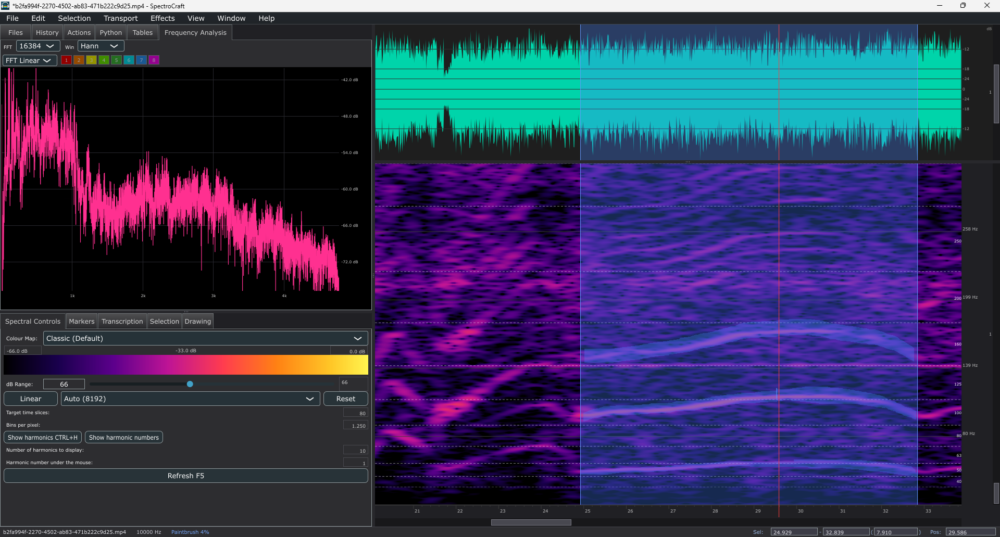

# SpectroCraft

## Introduction

**SpectroCraft** is an efficient spectral audio editor for advanced analysis, in the style of classic DAW waveform editors. Its tiled, multithreaded FFT spectrogram stays interactive on multi-hour, 96 kHz, 32-bit multichannel files without ever loading the whole file into RAM, and it ships with a full set of AI sound effects:

- **Stem separation** — split a mix into stems (vocals / drums / bass / other), including dedicated whine-hiss and click-bump removal models
- **Super resolution** — neural upsampling to 96/192 kHz
- **Noise suppression** — DeepFilterNet / DenseUNet denoising on CPU, GPU or NPU
- **Transcription** — Whisper speech-to-text with time-aligned markers
- **Content Aware Time Scale** — speed up or slow down audio while preserving pitch and spectral content

Beyond the graphical interface, SpectroCraft can be driven end to end by AI assistants through its built-in **MCP server**: a loopback command protocol inside the running app plus a Python MCP adapter (`tools/mcp`), so an agent can open files, run effects, measure levels and export results without touching the UI. Several **graph (tables) tracks** can be overlaid on the spectrogram at once, and several **video tracks** can be overlaid in the video window with per-track offsets, image adjustments and audio-based sync.

SpectroCraft is built with [JUCE 9](https://juce.com) (C++20 / CMake), runs neural inference on the [Intel OpenVINO](https://github.com/openvinotoolkit/openvino) runtime and [whisper.cpp](https://github.com/ggml-org/whisper.cpp), and gets stem separation & super resolution from [audio.cpp](https://github.com/0xShug0/audio.cpp). Its spectral analysis design follows the classic DAW tools it was inspired by, including [Audacity](https://www.audacityteam.org/) — the DeepFilterNet noise-suppression DSP is ported from Intel's OpenVINO AI plugins for Audacity. Full licence details are in [`THIRD_PARTY_NOTICES.md`](THIRD_PARTY_NOTICES.md).

## Installation

All releases are **portable**: download the zip for your platform, extract it and run the executable — no installer, no admin rights. The first time an AI feature is used, its model weights (tens to hundreds of MB) are downloaded automatically into your app-data folder (`%APPDATA%/SpectroCraft/models` on Windows); afterwards everything runs offline.

### Windows x64

1. Download `SpectroCraft-windows-x64.zip` from the [releases page](https://github.com/SuperMax3d/SpectroCraft/releases) and extract it anywhere (e.g. `C:\Tools\SpectroCraft`).
2. Run `SpectroCraft.exe`. The OpenVINO / whisper.cpp / FFmpeg runtime DLLs live in the `SpectroCraft/` subfolder next to the exe — keep them together if you move the app.
3. Optional: drop recorder plugins (ASIO, network, ...) into `recorders/` for extra capture devices; WASAPI capture and loopback ship out of the box.

### MacOS / Apple Silicon

1. Download `SpectroCraft-macos-arm64.zip` from the [releases page](https://github.com/SuperMax3d/SpectroCraft/releases) and extract it (e.g. into your Applications folder).
2. The app is **not signed with an Apple Developer ID**, so macOS Gatekeeper blocks the first launch (*"SpectroCraft cannot be opened because the developer cannot be verified"*). To grant access: right-click the app → **Open** — or open *System Settings → Privacy & Security* and click **Open Anyway**. Later launches start normally.
3. When you open a video file for the first time, macOS may ask permission to access it — allow it in the dialog.

### Linux x64

1. Download `SpectroCraft-linux-x64.zip` from the [releases page](https://github.com/SuperMax3d/SpectroCraft/releases) and extract it.
2. Make the binary executable: `chmod +x SpectroCraft`, then run it from a desktop session (the runtime libraries ship in the archive; `RUNPATH=$ORIGIN` finds them). Tested on Ubuntu 24.04 x86_64.

## Feature

The complete feature reference — waveform & spectral views, video window and tracks, recording, AI features (noise suppression, transcription, stem separation, super resolution), content aware time scale, tables, markers, keyboard shortcuts, CLI flags and the MCP / AI-control protocol — is in **[docs/Features.md](docs/Features.md)**.
